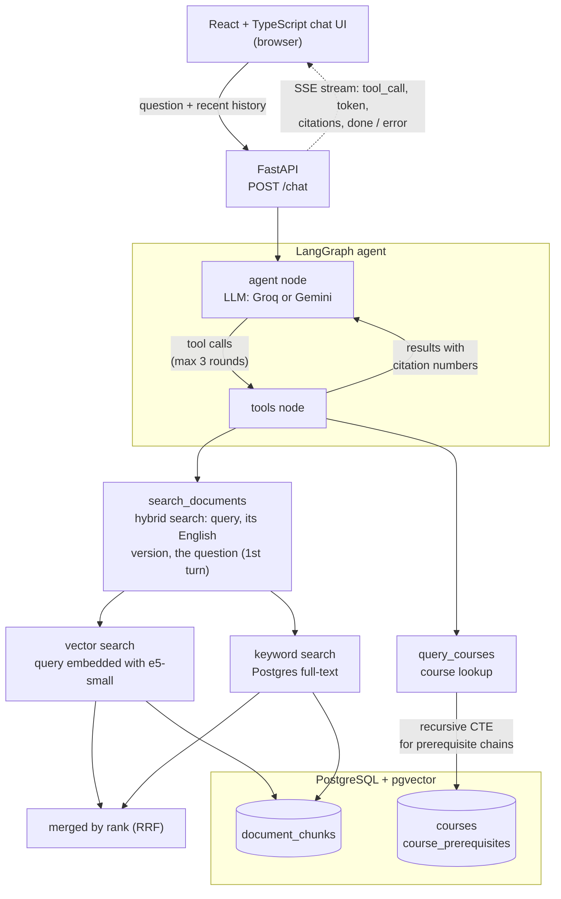
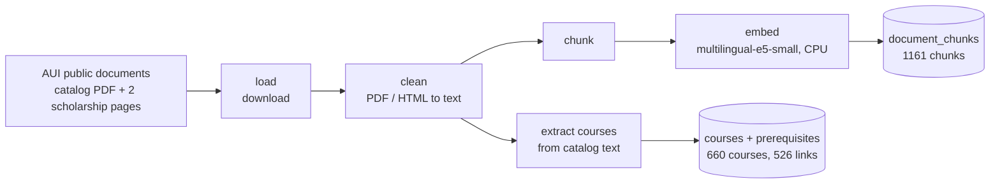

# Campus AI Assistant

A bilingual (English/French) assistant for Al Akhawayn University (AUI) students. It answers
questions about academic policies, the course catalog and scholarships, **cites the page each
answer comes from**, and uses an agent with tools to look up structured course data, e.g. *"What
are the prerequisites for ACC 2302?"* — including the full prerequisite chain.

An unofficial student project, not an official AUI service.

**Status:** the chat app, agent, CI and Docker setup are done (Phases 0–6), and a faithfulness
baseline is measured (see Evaluation). Next: fixes for the main faithfulness problems, a public
deployment for students, and a demo video.

---

## What it does

- **Answers only from university documents**, with numbered citations (`[1]`) linked to footnotes
  showing the source and page. When the documents don't cover a question, it says so instead of
  guessing.
- **Agent with two tools**, chosen per question by the LLM:
  - `search_documents` — hybrid search (vector + keyword) over the catalog and scholarship pages.
  - `query_courses` — SQL over 660 courses and 526 prerequisite links extracted from the catalog,
    following prerequisite chains recursively.
- **Streams the answer** token by token, showing which tool is running ("Looking up course
  ACC 2302").
- **English and French**: answers in the question's language; follow-up questions keep the
  conversation's context.

## Architecture

**Answering a question.** The agent node decides which tools to call; after 3 tool rounds it
must answer with what it has (enforced in code). Events stream back to the browser as they
happen.



**Getting the data in** (run once, offline):



## Tech stack

| Area | Choice |
|---|---|
| Backend | Python 3.12, FastAPI, Server-Sent Events |
| Agent | LangGraph (explicit `StateGraph`), LangChain tools |
| LLM | Groq `openai/gpt-oss-20b` (primary), Gemini `gemini-3.5-flash` (fallback), one config switch |
| Embeddings | `intfloat/multilingual-e5-small` via sentence-transformers, local CPU |
| Database | PostgreSQL 16 + pgvector; Postgres full-text search for keywords |
| Frontend | React 19 + TypeScript, Vite, react-markdown |
| Quality | pytest (163 tests), ruff, oxlint, retrieval and answer-faithfulness evaluation sets |
| Infra | Docker Compose (db + api + frontend), GitHub Actions CI |

## Design decisions worth knowing

- **Hybrid search with Reciprocal Rank Fusion.** Vector similarity and keyword `ts_rank` scores
  are on incompatible scales, so they're merged by *rank* (`1 / (60 + rank)`), not by score.
  Hybrid beat vector-only on the evaluation set with no regressions (numbers below).
- **Each search fuses several phrasings.** The documents are English, so the agent writes every
  search twice: in the question's language and in English (`query_en`, a required tool
  argument). On the first turn the student's own question is searched too, which counters the
  agent padding its queries. Each phrasing gets a vector and a keyword list, and RRF fuses them
  all; repeated phrasings are searched once. The question reaches the tool through LangGraph's
  `InjectedState`, hidden from the model's schema, so the model can't rewrite it.
- **Rules that must hold are enforced in code, not only in the prompt.** The model ignored "at
  most two searches" in testing, so the tool budget is enforced in the graph: after 3 tool rounds
  the model is called with no tools bound. Same for the answer language (detected in code and
  passed to the model) and citation brackets (normalized on the stream).
- **Citations are numbered per passage, once per request.** A passage returned by two searches
  keeps its first number, and only the sources the answer actually cites are sent to the UI.
- **Prerequisites are shown in the catalog's own wording, not parsed into AND/OR logic.** The
  catalog's wording is genuinely ambiguous (a comma means AND on some lines and OR on others), and
  a parser would turn that into confident wrong answers.
- **The server is stateless.** The browser sends the recent conversation with each question
  (last 10 messages, old citation markers stripped), so there is no session store.
- **The embedding model was chosen by measurement.** The first model's 128-token limit was
  silently truncating 99.8% of chunks; e5-small handles 512 tokens.

## Evaluation

Retrieval is measured on 12 hand-labelled questions (8 English, 4 French), each with a verbatim
sentence of the answer as an anchor (`eval/retrieval_eval_set.json`). A result is a hit if its
text contains the anchor, so the labels survive re-chunking:

| Method | Hit@3 | MRR | Hit@3 with section lines | MRR with section lines |
|---|---|---|---|---|
| Keyword (Postgres full-text) | 16.7% | 0.167 | 16.7% | 0.167 |
| Vector (pgvector, cosine) | 58.3% | 0.558 | 75.0% | 0.692 |
| Hybrid (RRF) | 75.0% | 0.646 | 83.3% | 0.720 |
| **Hybrid + English version (RRF over both phrasings)** | 91.7% | 0.715 | **100%** | **0.819** |

The English-version row is what `search_documents` does on a first turn. It changes only the 4
French questions, and their English versions here are exact translations, so it is likely
optimistic for the agent's own translations.

The last two columns are the current chunks: each starts with a "Section:" line naming its level
(Undergraduate or Graduate Studies) and nearest heading, e.g. `Section: Undergraduate Studies >
Repeat Policy`. Two alternative chunk boundaries (ending chunks at sentence ends, with or without
cutting before headings) were measured too and did worse on this eval (83.3% Hit@3), so the
original boundaries were kept, by a decision rule fixed before measuring. Two targeted checks
still fail with the kept chunks: for "What is the repeat policy for undergraduate students?" the
graduate rule ranks above the undergraduate one, and one chunk holds only part of the "nine
semesters" scholarship sentence. Only the heading-aware variant passed both.

Run it with `python -m app.evaluation.run_retrieval_eval` (in `backend/`, database seeded).

### Answer faithfulness: are cited claims supported by their passages?

**Method.** 34 questions (17 topics, each asked in English and French: 26 `main`, 4 known past
failures, 4 unanswerable) are answered by the real agent. Each answer is split into claims in
code (`split_claims.py`), and each claim is checked against the passages its citation points to.
Refusals ("I couldn't find…") and short list lead-ins ("The main options are:") are excluded from
scoring, because they state nothing about the university. Whether an answer *should* have declined
is checked separately, per answer, as false refusals and missed refusals. An LLM judge from a
different model family than the generator labels each claim supported, unsupported or no_claim.
For "supported", the judge must quote its evidence, and code checks that the quote really is in
one of the claim's passages; if not, the claim counts as unsupported.

**Can the judge be trusted?** Its labels are compared with my own hand labels on a 40-claim
stratified sample of run 1, labelled blind before the judge ran.

- *Original gate:* calibration 9/9 on hand-made cases, at least 32/40 agreement, and at most 2
  "lenient" errors (judge says supported, human says unsupported: the dangerous direction).
  - Gemini Flash (free tier): unusable (503 errors, 20 requests/day).
  - Qwen 3.8 27B: 25/40.
  - Mistral Large 2512: 27/40 (68%, kappa 0.22), 3 lenient errors.
- *Why that gate was unreachable:* my own two labelling passes on the same claims agree on only
  31/40. A judge can't be required to agree with me more than I agree with myself. Several
  disagreements were definition problems (refusals, lead-in fragments, advice), not judge
  errors.
- *What changed.* All of it was recorded in the project notes before the judge was re-run.
  - Refusals and lead-ins are excluded, which leaves 36 sample claims. My self-agreement on
    those is 31/36.
  - I adjudicated the 13 disagreements. That adjudication saw the judge's labels, so it may lean
    toward the judge. Agreement with my **original** labels is always reported next to the
    adjudicated one, and any new disagreements get a **blind** adjudication: two unnamed labels,
    in random order.
  - The judge prompt now requires a verbatim quote, and an unquotable claim must be labelled
    unsupported. The quote check normalizes quote characters, whitespace and case, and accepts
    "a … b" quotes only if every part is in the same passage.
- *New gate,* on the judge's final labels (after the quote check):
  - calibration 9/9;
  - at least **31/36** agreement with the adjudicated labels, i.e. my own self-agreement;
  - at most **2 lenient errors**.

  Label agreement and quote validity are reported separately. The judge is re-run once under
  these rules, and the result is reported whatever it is.

**Result of the re-run: the judge did not pass.** Mistral Large 2512 under the rules above, on
the 36 scored sample claims:

| | vs. my original labels | vs. adjudicated labels |
|---|---|---|
| Label agreement (judge's own label) | 27/36 = 75% (95% CI 59–86%), κ −0.12 | 31/36 = 86% (71–94%), κ 0.48 |
| **Final agreement** (after the quote check: **gated**) | 21/36 = 58% (42–73%), κ −0.09 | **27/36 = 75% (59–86%)**, κ 0.39 |
| Lenient errors (final) | 4 | **2** |
| Strict errors (final) | 10 | 7 |

- **Gate:** calibration 9/9 ✓; at most 2 lenient errors ✓ (2); at least 31/36 final agreement ✗
  (27/36).
- **Quote validity:** 92/115 = 80% of the judge's "supported" quotes were found verbatim in the
  claim's passages, across all of run 1 (75% in the sample). Under the earlier, looser prompt it
  was 68%.
- **Where the gap comes from:** most remaining disagreements are strict errors, the judge saying
  "unsupported" where I say "supported". Five of the seven are quotes that fail the check:
  - quotes joining two passages;
  - the judge's own words inside a quote;
  - a 3-word quote under the 4-word minimum.

  So the faithfulness numbers below likely **overstate** the problem. The judge also misses some
  real problems: 2 lenient errors.
- **Blind adjudication:** the judge's 5 new disagreements were decided without knowing which
  label was whose: 3 kept my original label, 2 went to the judge.
- κ is near or below zero against the original labels even at 75% agreement. Almost every label
  is "supported", so kappa punishes any disagreement heavily. Raw agreement with its interval is
  the more useful number here.

As decided in advance, judge work ends here: the judge's rules are frozen from this point. Run 2
was later judged with the same frozen judge (calibration re-checked first: 9/9) as a second
baseline, which doubles the sample. Both baselines must be read together with the judge's 75%
agreement.

**Faithfulness baseline (runs 1 and 2, 34 answers each, judged by Mistral Large 2512):**

| Group | Run 1 | Run 2 | **Runs 1 + 2** |
|---|---|---|---|
| `main` (all) | 10/24 = 41.7% (24.5–61.2%) | 7/23 = 30.4% (15.6–50.9%) | **17/47 = 36.2% (24.0–50.5%)** |
| `main` English | 4/12 = 33.3% | 5/12 = 41.7% | 9/24 = 37.5% (21.2–57.3%) |
| `main` French | 6/12 = 50.0% | 2/11 = 18.2% | 8/23 = 34.8% (18.8–55.1%) |
| Known past failures | 3/4 | 3/4 | 6/8 |
| Unanswerable | 0/4 (none cite anything) | 0/3 (none cite anything) | 0/7 |
| Crashed (all sets) | 2 | 4 | 6 |

Each cell is answers with ≥ 1 unsupported cited claim, out of answers that didn't crash, with a
95% Wilson interval.

- **Run-to-run variance is large.** French went from 50% to 18% between two runs of the same
  questions, and the intervals overlap heavily. With about 24 answers per group, no EN/FR
  difference can be read from these numbers. Only large before/after effects will show.
- **False refusals:** 5/55, all in French. Scholarship conditions and MTH 1305 were declined in
  both runs; international scholarships, a known past failure, was declined in run 2.
- **Missed refusals:** the report counts 2/7 (`instructor_en` in run 1, `fulbright_en` in run 2).
  Both are judge errors: each answer plainly declines ("I can't find any specific information…").
  By hand, the assistant declined all 7 unanswerable questions it answered.
- **Excluded from scoring:** 12 of 156 claims in run 1 and 13 of 148 in run 2 (lead-ins and
  refusals), all listed in the report.
- **Crashes:** 6 answers hit the known forced-answer error and have no claims.
- **Cost:** the judge runs on Mistral's pay-as-you-go API, about $0.06 per run.

**Why answers fail.** Each failure was given one cause: every unsupported cited claim in a
`main` answer, every false refusal and every crash. That is 18 failures in run 1 (14 claims in 10
answers, 2 false refusals, 2 crashes) and 21 in run 2 (14 claims in 7 answers, 3 false refusals,
4 crashes). For both runs, the causes were proposed by an AI assistant and reviewed by the
author, who accepted all of them: 18/18 in run 1, 21/21 in run 2
(`eval/results/faithfulness/error_analysis_run1.md`, `error_analysis_run2.md`):

| Cause | Run 1 | Run 2 | Total |
|---|---|---|---|
| Judge artifact (the claim *is* supported; the quote check failed it) | 5 | 8 | 13 |
| French retrieval (the right passage was never retrieved) | 4 | 2 | 6 |
| Citation placement (the fact is in a retrieved passage, not the cited one) | 2 | 4 | 6 |
| Forced-final-answer crash | 2 | 4 | 6 |
| Embellishment (a gloss, hedge or step no passage gives) | 2 | 1 | 3 |
| Uncitable tool result (`query_courses` "no description") | 1 | 1 | 2 |
| Graduate rules presented as general | 1 | 0 | 1 |
| Heading or number cut off by a chunk boundary | 1 | 0 | 1 |
| Misread (the cited passage contradicts the claim; a cause added in run 2) | 0 | 1 | 1 |

Set the judge artifacts aside and **11 of 47 `main` answers fail by hand** (7/24 in run 1, 4/23
in run 2), against the judge's 17. This hand count only re-checks what the judge called
unsupported; it can't recover the judge's lenient errors. Of the 13 artifacts:
- 6 are quotes that join two passages on claims that rightly cite both, which the one-passage
  quote rule fails (2 in run 1, 4 in run 2);
- 4 come from PDF text: "and/ or" spacing (3) and a line-break hyphen, "com- munity" (1);
- 2 are 3-word quotes under the 4-word minimum;
- 1 quotes a passage the claim doesn't cite, while the cited passage supports the claim (a
  borderline case, `w_grade_en#3`).

Those rules stay fixed, so that before and after fixes are judged identically. The hand count
is reported alongside to correct for them.

**AI assistance in the labels.**
- The 13 first-round adjudication decisions are the author's. The disagreement listing they were
  made from was written by the AI assistant, and on 6 of them the author asked for its opinion
  before deciding. Those 6 are marked `ai_assisted` in `adjudications_run1.json`.
- In the blind round, the assistant built the A/B page and gave no opinions. The author wrote
  2 of the 5 notes with an AI tool (accurate, per the author). Those 2 are marked `ai_assisted`
  in `adjudications_run1_blind.json`.
- The original 40 hand labels were made before any AI opinion on them.

These numbers set the starting point for the fixes. The same pipeline measures the result.

## Running it

### Prerequisites

Docker Desktop, Python 3.12, Node 24, and a free API key from
[Groq](https://console.groq.com) (and optionally [Google AI Studio](https://ai.google.dev) for the
Gemini fallback).

```powershell
copy .env.example .env    # then put your API key(s) in .env
```

### 1. Database and data (first time only)

The database starts empty. These steps download the public AUI documents, process them and fill
the database. The first run also downloads the embedding model (~470 MB).

```powershell
docker compose up -d db

cd backend
python -m venv .venv
.\.venv\Scripts\Activate.ps1
pip install -e ".[dev]"

python -m app.ingestion.load      # download the documents (list mirrors data/sources.md)
python -m app.ingestion.clean     # PDF/HTML -> text
python -m app.ingestion.chunk     # text -> chunks
python -m app.ingestion.store     # embed chunks -> document_chunks
python -m app.ingestion.courses   # catalog -> courses + prerequisites
```

### 2a. Run everything in Docker

```powershell
docker compose up -d --build
```

Open http://localhost:8080. The API is on http://localhost:8000 (`/health`, `/chat`).

### 2b. Or run for development (hot reload)

```powershell
# terminal 1, in backend\ with the venv active
uvicorn app.main:app --reload --port 8000

# terminal 2, in frontend\
npm install
npm run dev
```

Open http://localhost:5173. (Stop the `api` container first if it's running: both use port 8000.)

## Tests and CI

```powershell
cd backend
pytest -q          # 50 tests; the Postgres ones skip if the database isn't running
ruff check . ; ruff format --check .
```

Every push and pull request runs three GitHub Actions jobs (`.github/workflows/ci.yml`): ruff,
pytest against a real pgvector service container (seeded with the course data first, so the
database tests run instead of skipping), and the frontend lint + type-check + build. The agent
tests use a fake model, so CI makes no LLM calls.

## Project structure

```
backend/
  app/
    agent/        LangGraph graph, tools, citations, history, language detection
    retrieval/    vector, keyword and hybrid search
    ingestion/    load -> clean -> chunk -> store; course extraction
    evaluation/   retrieval evaluation runner
    db/           connection helper, schema.sql
    main.py       FastAPI app: /health, /chat (SSE)
  tests/
frontend/src/     App.tsx (chat UI), chatStream.ts (SSE client), types.ts
eval/             retrieval evaluation set
data/             sources.md (document URLs); raw/ and processed/ are generated
```

## Known limitations

- **Cited answers can still contain wrong details.** In the baseline (runs 1 and 2), 17 of 47
  main answers (36%) had at least one cited claim the judge found unsupported, 11 of 47 by hand. The judge itself agrees with
  hand labels on 75% of claims and tends to be too strict (see Evaluation).
- **French questions over English documents.** All sources are English. Each search now also
  runs an English version written by the agent, which retrieves all 4 French evaluation
  questions' passages (2 before); how well the agent's own translations do is measured in the
  next faithfulness runs.
- **The agent sometimes pads its search queries** ("MTH 1305 Al Akhawayn University course
  description"), which can push the right passage down the ranking. The student's own question
  is now searched alongside on the first turn; follow-ups rely on the agent's query.
- **Free-tier LLM limits.** Groq's daily token limit caps usage; history is capped at 10 messages
  to keep requests small.
- **No authentication or rate limiting yet**, needed before a public deployment.

## Future work

- **A search-time level filter (undergraduate vs. graduate).** Every chunk is tagged with its
  level (a `level` column and its "Section:" line), but search doesn't use it yet. The two
  targeted retrieval checks still fail: for an undergraduate repeat-policy question the graduate
  rule ranks first, and one chunk holds only part of a scholarship-duration sentence. Filtering
  or boosting by the level the question names (or asking the student) is the real fix for the
  first; the section lines alone don't reorder these results.
- **A second after-fix run (run 4)** to measure run-to-run variance, which was large between the
  two baseline runs (French 50% → 18%).
- **Citation placement (6 failures in the baseline):** the fact is in a retrieved passage, but
  the answer cites a different one.

## Data

Only public AUI documents are used (listed with URLs in `data/sources.md`); no personal student
data is stored. The server doesn't save questions, but each question and the retrieved passages
are sent to the LLM provider (Groq, or Google for Gemini) to generate the answer.
